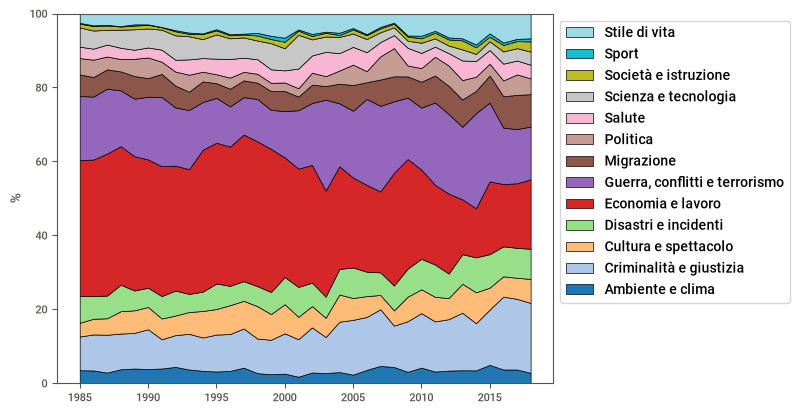
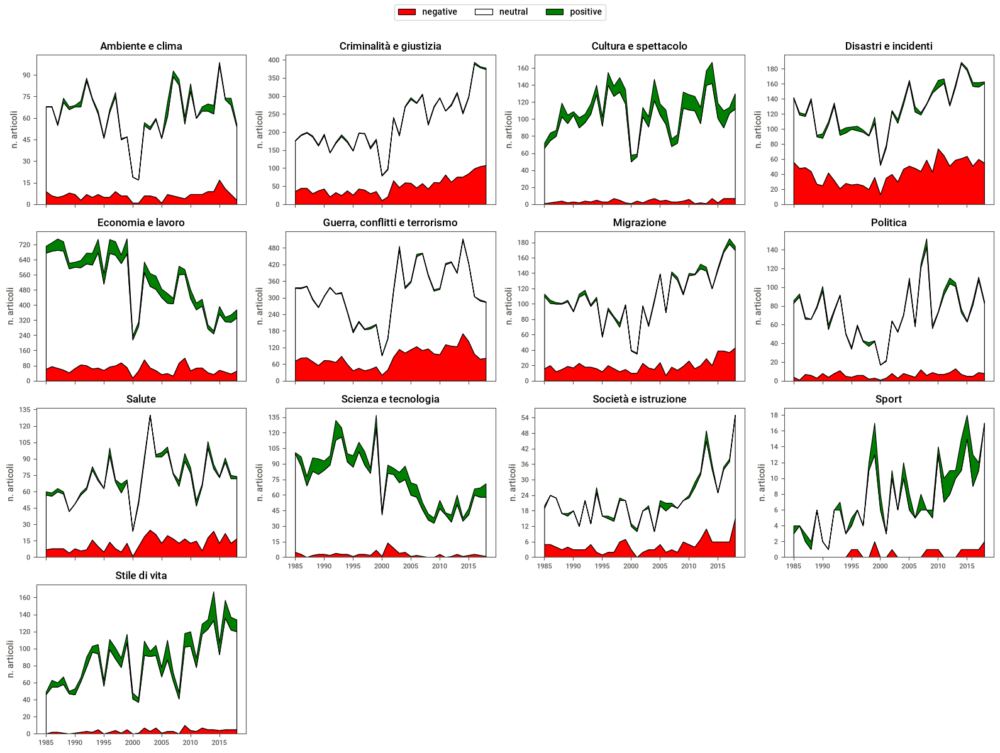
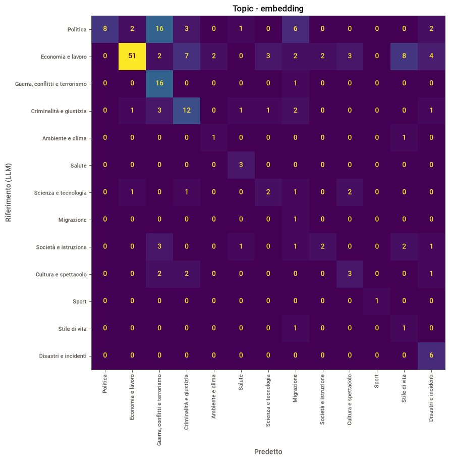
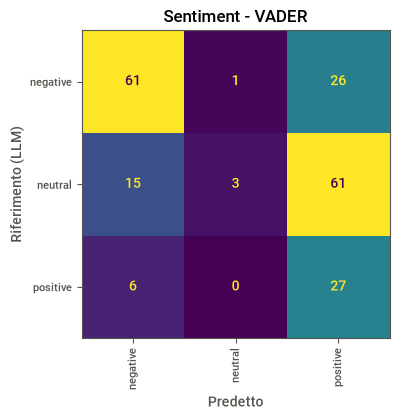
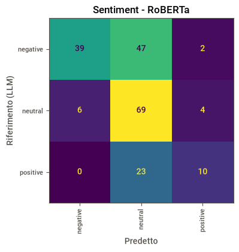

# Analisi di notizie del New York Times: topic e sentiment

🎥 **Video di presentazione**: [YouTube](https://www.youtube.com/watch?v=72Z_guegKQA) · 🌐 [paonapolitano.it](https://paonapolitano.it)

Prendiamo decisioni in base alle informazioni che abbiamo, e i notiziari sono una delle fonti principali. Capire **di cosa parlano le news e con che tono** aiuta a leggerle in modo più consapevole.

Questo progetto analizza **66.038 articoli del New York Times dal 1985 al 2018** (circa 2.000 per anno) per rispondere a due domande:
- Con il passare degli anni si parla sempre delle stesse cose?
- Come cambia il tono in base all'argomento?

Il dataset non contiene nessun campo con l'argomento né con il tono, quindi per ogni articolo:
1. **classifico il topic** in una delle 13 categorie *IPTC Media Topics*, senza addestrare nessun modello (classificazione *zero-shot* con gli embedding);
2. **misuro il sentiment** con due metodi molto diversi, **VADER** (dizionario di parole) e **RoBERTa** (modello transformer);
3. **valido i risultati** confrontandoli con le etichette assegnate da un LLM (Claude Opus) a **200 articoli** scelti a caso, con confusion matrix e accuracy.

## Risultati in breve

- **Gli argomenti cambiano**: *Economia e lavoro* passa da circa il 37% degli articoli (1985) al 19% (2018), mentre *Criminalità e giustizia* sale dal 9% al 19%. *Guerra, conflitti e terrorismo* ha picchi nel 2003 e nel 2014 (circa 25%).
- **Il tono non cambia in modo evidente**: gli articoli negativi aumentano in alcuni topic, ma aumentano in proporzione al numero di articoli. Una differenza reale non si osserva.
- **RoBERTa è più affidabile di VADER** per il sentiment (accuracy 0.59 contro 0.46 rispetto all'LLM).

## Pipeline

| Fase         | Cosa faccio                                                                                                                        | Codice                                                        |
| ------------ | ---------------------------------------------------------------------------------------------------------------------------------- | ------------------------------------------------------------- |
| Esplorazione | Report interattivo con Sweetviz (colonne, valori mancanti, distribuzioni)                                                          | notebook, sezione 1                                           |
| Pulizia      | Tengo e rinomino 5 colonne (autore, data, sezione, titolo, testo), rimuovo articoli senza testo e duplicati                        | `cleaning.clean_news`                                         |
| Embedding    | Titolo + testo di ogni articolo diventano vettori grazie a `all-MiniLM-L6-v2`                                                      | notebook, sezione 3                                           |
| Topic        | Ogni articolo va al topic con la descrizione più simile (similarità coseno)                                                        | `analisi.classify`                                            |
| Sentiment 1  | VADER: punteggio `compound` tra -1 e 1, soglie standard ±0.05                                                                      | `analisi.label_sentiment`                                     |
| Sentiment 2  | RoBERTa (`cardiffnlp/twitter-roberta-base-sentiment-latest`): testo diviso in chunk da 510 token, probabilità mediate per articolo | `analisi.df_to_token`, `chunk_prediction`, `aggregate_chunks` |
| Validazione  | 200 articoli a caso etichettati da un LLM con le stesse definizioni, poi confusion matrix e accuracy                                | `analisi.llm_prompt_files`, `load_llm_labels`, `llm_accuracy` |

### Esplorazione e pulizia
Il report Sweetviz ([`immagini/SWEETVIZ_REPORT.html`](immagini/SWEETVIZ_REPORT.html)) ha evidenziato colonne completamente vuote, articoli senza testo e duplicati:

| | Righe |
|---|---|
| Articoli iniziali | 66.038 |
| Senza titolo o testo | −1.828 |
| Duplicati | −599 |
| **Articoli analizzati** | **63.611** |

### Come funziona la classificazione con gli embedding
Un embedding trasforma un testo in un vettore in uno spazio a molte dimensioni: **testi che parlano dello stesso argomento finiscono vicini**, testi su argomenti diversi finiscono lontani. Per esempio, i vettori di *Guerra e conflitti* e *Disastri e incidenti* sono vicini (si parla in entrambi di morti e distruzione), mentre *Sport* è lontano.

Trasformo in vettori sia gli articoli sia una breve descrizione di ciascun topic (in inglese, come gli articoli), e assegno ogni articolo al topic più vicino. Il limite di questo approccio è che alcune categorie sono vicine tra loro, e gli articoli "a metà strada" possono finire nella categoria sbagliata.

## Topic nel tempo



| Topic | 1985 | 2018 | Note |
|---|---|---|---|
| Economia e lavoro | 37% | 19% | minimo nel 2014 (13%) |
| Criminalità e giustizia | 9% | 19% | crescita costante dal 2002 |
| Guerra, conflitti e terrorismo | 17% | 14% | picchi nel 2003 (25%) e 2014 (26%) |
| Stile di vita | 2.5% | 7% | |
| Scienza e tecnologia | 5% | 3.6% | picco nel 2001 (9%), circa 2% nel 2008–2014 |

Gli altri topic restano abbastanza stabili.

## Sentiment

### VADER: quasi niente è neutro
VADER assegna a ogni parola un punteggio (es. *beautiful* positivo, *terrible* negativo) e li somma. Il risultato sul dataset: **64% positivi, 35% negativi, solo 2% neutri**, l'opposto di quello che ci si aspetta da articoli giornalistici, scritti con un linguaggio volutamente neutro.

I motivi:
- **Lunghezza dei testi**: VADER è pensato per testi brevi come i tweet. In un articolo di migliaia di parole il punteggio si accumula e satura verso ±1, quindi la fascia "neutra" (tra −0.05 e +0.05) viene superata quasi sempre.
- **Contesto**: alcune parole hanno una connotazione diversa a seconda del contesto (es. *budget* sui social può essere negativo, in un articolo finanziario è neutro).

### RoBERTa: risultati più realistici
Il modello transformer dà **78% neutri, 16% negativi, 5% positivi**, molto più vicino a quello che ci aspettiamo.



Per confronto, lo stesso grafico con VADER: [`immagini/sentiment_VADER.png`](immagini/sentiment_VADER.png).

**Conclusione**: in alcuni topic (es. *Criminalità e giustizia*, *Guerra*) gli articoli negativi aumentano, ma aumentano in proporzione al numero totale di articoli. Una variazione reale del tono nel tempo non si osserva.

### Il problema computazionale
Con RoBERTa il mio PC ha impiegato **circa 40 minuti per 1.000 articoli**: per 63.000 articoli sarebbero servite quasi due giornate. Le ottimizzazioni:
1. **Un solo chunk per articolo** (`max_chunks=1`): si analizzano solo i primi ~510 token (circa 380 parole). 2.1× più veloce, con il 93% delle etichette invariate (verificato sul campione di prova).
2. **Chunk ordinati per lunghezza** prima di formare i batch: i testi corti vengono processati insieme e il padding è minimo. Stessi risultati, 1.4× più veloce.
3. **GPU**: due righe di codice per spostare modello e tensori su GPU (`.to(device)`), poi esecuzione su **Google Colab**.

Risultato: **circa 30 minuti per l'intero dataset**, meno di quanto il PC impiegava per 1.000 articoli.

## Validazione con un LLM

Non esiste un'etichetta "vera" per questi articoli, quindi ho estratto 200 articoli a caso e li ho fatti classificare a **Claude Opus** (topic e sentiment, con le stesse definizioni usate dagli altri metodi).

| Metodo | Accuracy vs LLM (200 articoli) |
|---|---|
| Topic - embedding | 0.54 |
| Sentiment - VADER | 0.46 |
| Sentiment - RoBERTa | **0.59** |

### Topic: l'errore di *Scienza e tecnologia*
In una prima versione molti articoli di **economia** venivano classificati come **Scienza e tecnologia**. Leggendo a mano gli articoli sbagliati ho visto che erano notizie su aziende tecnologiche (licenziamenti, bilanci...) in cui comparivano parole come *computer*, *telefono*, *elettronica*: le stesse che avevo usato nella descrizione del topic.

Ho riscritto la descrizione di *Scienza e tecnologia* concentrandola su **scoperte ed esperimenti scientifici**: il vettore del topic si è spostato e quell'errore è praticamente scomparso (ora solo 3 articoli di economia su 84 finiscono in *Scienza e tecnologia*). Le descrizioni dei topic sono, di fatto, parte del modello.



- Funziona bene su *Economia e lavoro* (precision 0.93), *Guerra, conflitti e terrorismo* (recall 0.94) e *Disastri e incidenti* (recall 1.00).
- **L'errore principale ora è *Politica* classificata come *Guerra, conflitti e terrorismo*** (16 casi su 38, recall di *Politica* 0.21): molti articoli politici parlano di politica estera e conflitti, e i due topic sono vicini nello spazio degli embedding.

### Sentiment

| VADER | RoBERTa |
|---|---|
|  |  |

I due metodi sbagliano in direzioni opposte:
- **VADER** quasi non assegna mai `neutral` (recall 0.04): 61 articoli neutri su 79 diventano positivi.
- **RoBERTa** tende verso `neutral`: quando dice `negative` ha quasi sempre ragione (precision 0.87), ma ne trova meno della metà (recall 0.44). È addestrato su tweet e misura il tono di chi scrive, mentre gli articoli del NYT mantengono un registro distaccato anche quando raccontano eventi negativi.

## Limiti
- **L'LLM non è la verità**: le metriche misurano l'accordo con l'LLM, non l'accuratezza reale. Il prompt definisce il sentiment includendo gli eventi riportati, mentre RoBERTa misura solo il tono del linguaggio: parte del suo errore viene da questa differenza di definizione.
- **Campione di validazione piccolo**: 200 articoli su 13 topic, alcuni topic hanno 1–3 esempi; le metriche per i topic rari sono solo indicative.
- **Campione del dataset**: circa 2.000 articoli per anno (meno nel 2000 e 2001), non l'intero archivio del NYT.
- **RoBERTa con `max_chunks=1`** guarda solo i primi ~380 vocaboli di ogni articolo.

## Struttura del progetto

```
├── notebooks/
│   └── analisi_notizie_nyt.ipynb   ← il notebook con tutta l'analisi, dall'esplorazione alle conclusioni
├── src/analisi_notizie/            ← il codice, richiamato dal notebook
│   ├── config.py                   ← percorsi, parametri, topic IPTC, prompt per l'LLM
│   ├── cleaning.py                 ← pulizia del dataset
│   ├── analisi.py                  ← topic, sentiment (VADER e RoBERTa), validazione con LLM
│   └── graphs.py                   ← grafici
├── scripts/
│   └── merge_full_text_csv.py      ← unisce i CSV originali del NYT (uno per anno) in un unico file
├── immagini/                       ← grafici e report Sweetviz usati in questo README
├── .data/                          ← dati (non su Git)
├── pyproject.toml                  ← dipendenze
└── uv.lock                         ← versioni esatte
```

## Come eseguirlo

Serve [uv](https://docs.astral.sh/uv/) e Python 3.13.

```powershell
uv sync                                   # crea .venv e installa dipendenze e pacchetto
```

1. Metti il dataset in `.data/NYT_news.csv` (colonne usate: `writer_name`, `pub_date`, `section_name`, `main_headline`, `body_text`).
2. Apri `notebooks/analisi_notizie_nyt.ipynb` in VS Code e seleziona il kernel di `.venv`.
3. Esegui le celle in ordine. La cella di RoBERTa è la più pesante: su CPU servono circa 40 minuti ogni 1.000 articoli, quindi per il dataset completo conviene una GPU (es. Google Colab). Il codice usa la GPU in automatico se disponibile.
4. Per la validazione: la cella della sezione 7 crea `.data/llm_prompt_1.txt` … `llm_prompt_8.txt` (25 articoli ciascuno); incolla ciascuno in un LLM e salva le risposte in `.data/llm_labels.csv` (istruzioni nel notebook).

## Tecnologie
Python 3.13 · pandas · scikit-learn · sentence-transformers · transformers / PyTorch · vaderSentiment · matplotlib · plotly · Sweetviz · uv · ruff · Google Colab
