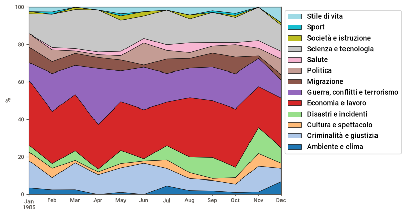
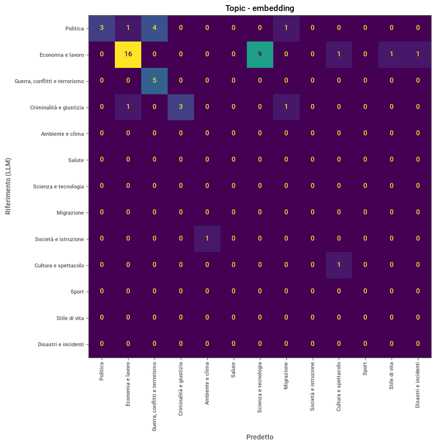
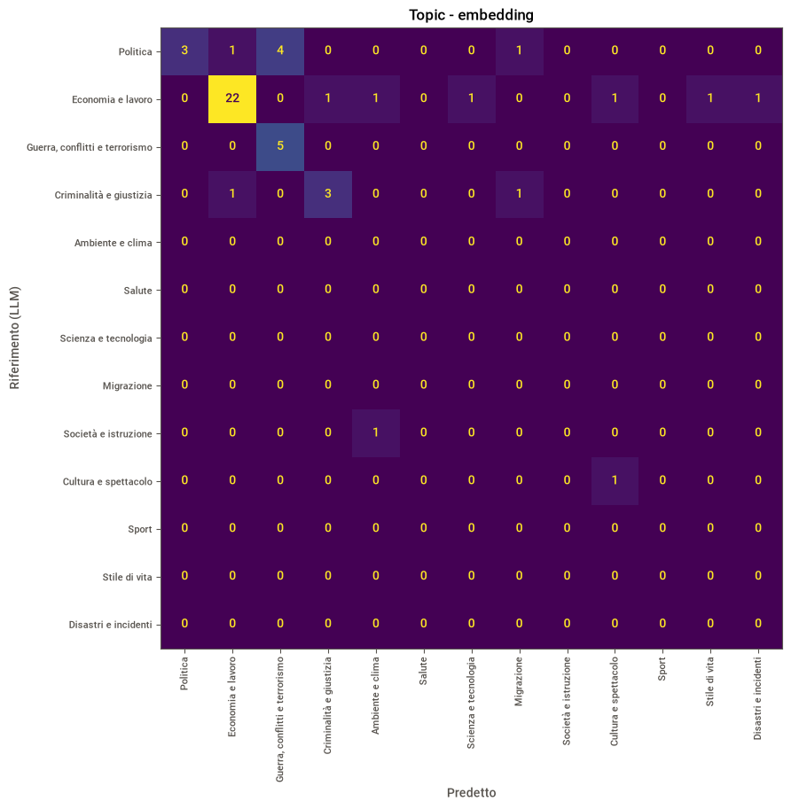
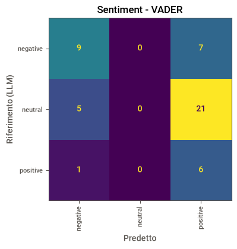
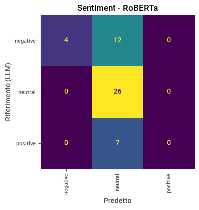
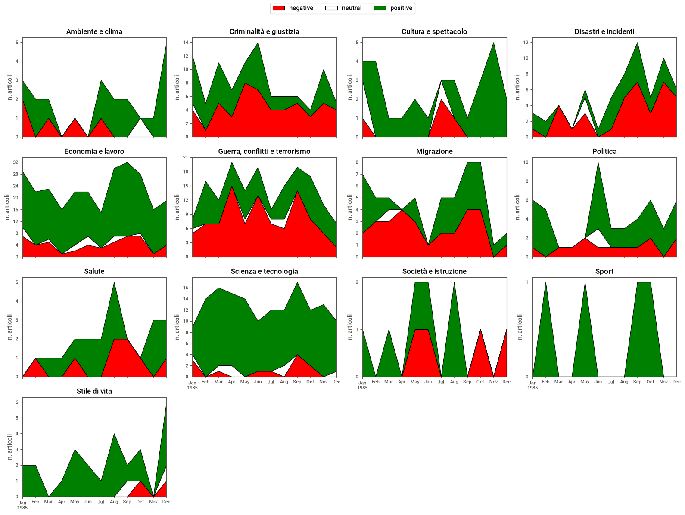
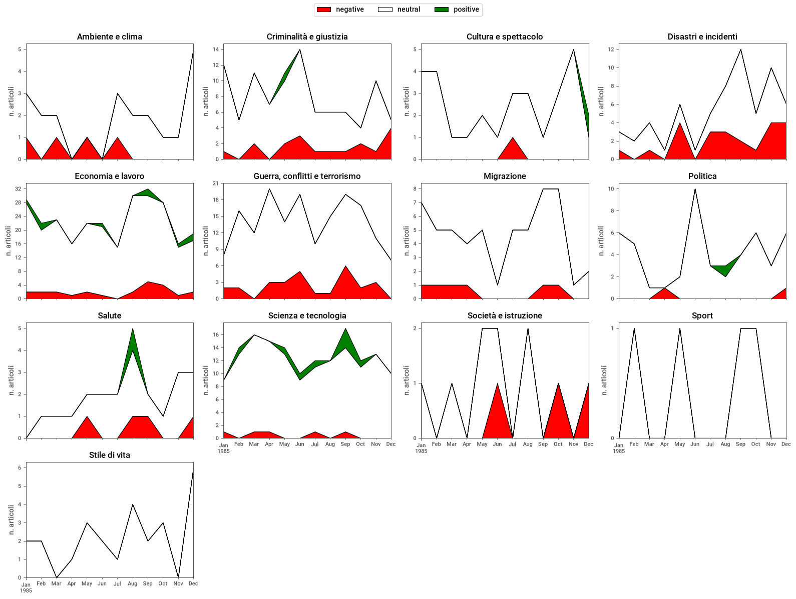

# Analisi di notizie del New York Times: topic e sentiment

Progetto di NLP su un campione di ==***1000* articoli del New York Times del 1985**==. 
**l'obiettivo è rispondere a queste domande**:
- Con il passare degli anni si parla sempre delle stesse cose?
- Come cambia il tono in base all’argomento?

Per ogni articolo:
1. **classifico il topic** in una delle 13 categorie *IPTC Media Topics*, senza addestrare nessun modello (classificazione *zero-shot* con gli embedding);
2. **misuro il sentiment** con due metodi molto diversi, **VADER** (dizionario di parole) e **RoBERTa** (modello transformer);
3. **valido i risultati** confrontandoli con le etichette assegnate da un LLM a ==50== articoli, con confusion matrix e accuracy.

## Pipeline

| Fase         | Cosa faccio                                                                                                                        | Codice                                                        |
| ------------ | ---------------------------------------------------------------------------------------------------------------------------------- | ------------------------------------------------------------- |
| Esplorazione | Report interattivo con Sweetviz (colonne, valori mancanti, distribuzioni)                                                          | notebook, sezione 1                                           |
| Pulizia      | Tengo e rinomino 5 colonne (autore, data, sezione, titolo, testo), rimuovo articoli senza testo e duplicati                        | `cleaning.clean_news`                                         |
| Embedding    | Titolo + testo di ogni articolo  diventano vettori grazie a `all-MiniLM-L6-v2`                                                     | notebook, sezione 3                                           |
| Topic        | Ogni articolo va al topic con la descrizione più simile (similarità coseno)                                                        | `analisi.classify`                                            |
| Sentiment 1  | VADER: punteggio `compound` tra -1 e 1, soglie standard ±0.05                                                                      | `analisi.label_sentiment`                                     |
| Sentiment 2  | RoBERTa (`cardiffnlp/twitter-roberta-base-sentiment-latest`): testo diviso in chunk da 510 token, probabilità mediate per articolo | `analisi.df_to_token`, `chunk_prediction`, `aggregate_chunks` |
| Validazione  | ==50== articoli a caso etichettati da un LLM con le stesse definizioni, poi confusion matrix e accuracy                            | `analisi.llm_prompt_files`, `load_llm_labels`, `llm_accuracy` |

### Dettagli tecnici
- **Topic zero-shot**: le descrizioni dei topic sono scritte in inglese, come gli articoli, così testi e categorie stanno nello stesso spazio vettoriale. Le descrizioni sono parte del "modello": rendere più specifica quella di *Scienza e tecnologia* (prima includeva aziende tech e software) ha portato *Economia e lavoro* da 16 a 22 articoli corretti su 28.
- **RoBERTa più veloce su CPU**: i chunk vengono ordinati per lunghezza prima di formare i batch, così il padding è minimo (stessi risultati, 1.4× più veloce); con `max_chunks=1` si usa solo il primo chunk di ogni articolo (2.1× più veloce, 93% delle etichette invariate).
- **Validazione con LLM**: il prompt (in `config.py`) usa le stesse descrizioni dei topic degli embedding, e chiede un CSV separato da `;` con un ID per articolo, così le risposte si ricollegano alle righe giuste e vengono controllate (ID mancanti, etichette non valide).

## Risultati

Accordo di ogni metodo con le etichette dell'LLM, su 49 articoli (uno dei 50 non è stato restituito dall'LLM):

| Metodo | Accuracy vs LLM |
|---|---|
| Topic - embedding | **0.69** |
| Sentiment - VADER | 0.31 |
| Sentiment - RoBERTa | **0.61** |

### Topic


| Prima (descrizione di *Scienza e tecnologia* generica) | Dopo (descrizione più specifica) |
|---|---|
|  |  |

- Funziona bene sui temi più frequenti: *Economia e lavoro* (precision 0.92) e *Guerra, conflitti e terrorismo* (recall 1.00).
- L'errore principale è *Politica* classificata come *Guerra, conflitti e terrorismo* (4 casi su 9): nel 1985 molti articoli politici parlano di politica estera, Guerra Fredda e conflitti.

### Sentiment
| VADER | RoBERTa |
|---|---|
|  |  |

I due metodi sbagliano in direzioni opposte:

- **VADER non assegna mai `neutral`** (4% degli articoli nel dataset): somma il peso emotivo di ogni parola e su testi di centinaia di parole il punteggio satura verso ±1. Quasi tutto diventa positivo (64%) o negativo (32%).
- **RoBERTa mette quasi tutto in `neutral`** (86%): è addestrato su tweet e misura il tono di chi scrive, mentre gli articoli del NYT hanno un registro volutamente distaccato anche quando raccontano eventi negativi. Quando dice `negative` ha ragione (precision 1.00), ma ne trova solo un quarto (recall 0.25). Il comportamento non dipende dalla lunghezza: anche su titoli e singole frasi resta neutro nell'81–93% dei casi.

Sentiment per topic nel tempo, con VADER e con RoBERTa:




## Limiti
- **L'LLM non è la verità**: le metriche misurano l'accordo con l'LLM, non l'accuratezza reale. Il prompt definisce il sentiment includendo gli eventi riportati, mentre RoBERTa misura solo il tono del linguaggio: parte del suo errore viene da questa differenza di definizione.
- **Campione piccolo**: 49 articoli su 13 topic, alcuni topic hanno 0–1 esempi; le metriche per i topic rari sono solo indicative.
- **Un solo anno** (1985): i grafici nel tempo sono mensili e la distribuzione dei topic riflette quel periodo storico.
- **RoBERTa con `max_chunks=1`** guarda solo i primi ~380 vocaboli di ogni articolo.

## Struttura del progetto

```
├── notebooks/
│   └── analisi_notizie_nyt.ipynb   ← il notebook con tutta l'analisi, dall'esplorazione alle conclusioni
├── src/analisi_notizie/            ← il codice, richiamato dal notebook
│   ├── config.py                   ← percorsi, parametri, topic IPTC, prompt per l'LLM
│   ├── cleaning.py                 ← pulizia del dataset
│   ├── analisi.py                  ← topic, sentiment (VADER e RoBERTa), validazione con LLM
│   └── graphs.py                   ← grafici
├── scripts/
│   └── merge_full_text_csv.py      ← unisce i CSV originali del NYT (uno per anno) in un unico file
├── images/                         ← grafici usati in questo README
├── .data/                          ← dati (non su Git)
├── pyproject.toml                  ← dipendenze
└── uv.lock                         ← versioni esatte
```

## Come eseguirlo

Serve [uv](https://docs.astral.sh/uv/) e Python 3.13.

```powershell
uv sync                                   # crea .venv e installa dipendenze e pacchetto
```

1. Metti il dataset in `.data/NYT_sample.csv` (colonne usate: `writer_name`, `pub_date`, `section_name`, `main_headline`, `body_text`).
2. Apri `notebooks/analisi_notizie_nyt.ipynb` in VS Code e seleziona il kernel di `.venv`.
3. Esegui le celle in ordine. La cella di RoBERTa richiede circa 20 minuti su CPU.
4. Per la validazione: la cella della sezione 7 crea `.data/llm_prompt_1.txt` e `llm_prompt_2.txt`; incolla ciascuno in un LLM e salva le risposte in `.data/llm_labels.csv` (istruzioni nel notebook).

## Tecnologie
Python 3.13 · pandas · scikit-learn · sentence-transformers · transformers / PyTorch · vaderSentiment · matplotlib · plotly · Sweetviz · uv · ruff
